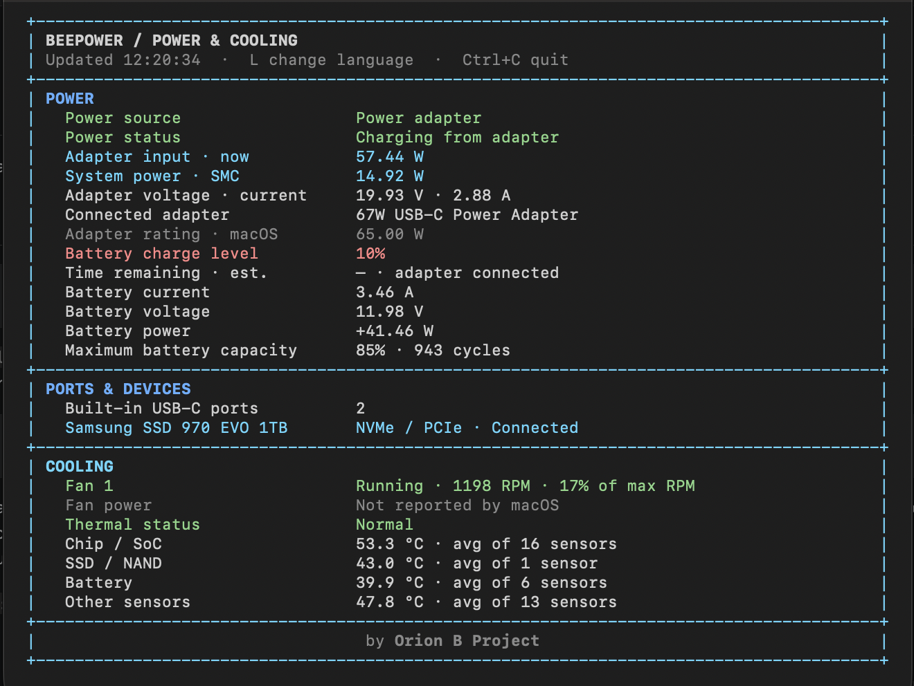
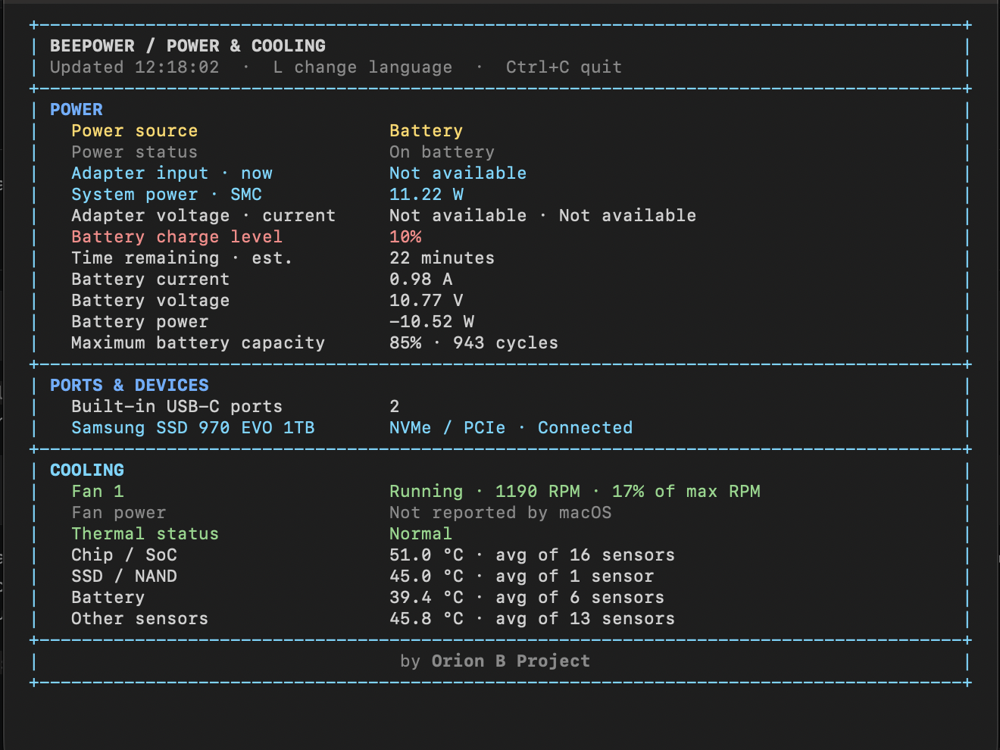

# ⚡ Beepower

Beepower is a terminal dashboard for Mac power, battery, cooling, temperatures, and connected USB devices.

[](https://github.com/dedinopriadi/homebrew-beepower/releases)
[](#requirements)
[](#requirements)
[](LICENSE)

## 🖥️ Screenshots

<table>
  <tr>
    <th>Charging</th>
    <th>On battery</th>
  </tr>
  <tr>
    <td></td>
    <td></td>
  </tr>
</table>

## 📦 Install

Install with Homebrew:

```sh
brew install dedinopriadi/beepower/beepower
```

Start the dashboard:

```sh
beepower
```

Press `L` to switch between English and Indonesian. Press `Ctrl+C` to quit.

## 📋 Readings

- Power adapter input, system power, battery level, health, and estimated time remaining.
- Fan speed and available temperature readings grouped by component.
- Connected USB devices, device-reported USB version, and negotiated link speed when available.

macOS does not report fan power or live USB power draw. USB current is taken from the device descriptor. Available readings vary by Mac model and macOS version.

## 💻 Requirements

- macOS 13 or later on Apple Silicon
- [Homebrew](https://brew.sh)
- An interactive terminal at least 50 columns wide

## 🔄 Updates

To update Beepower, run:

```sh
brew update
brew upgrade beepower
```

## 🐛 Issues

For installation or formula issues, [open an issue](https://github.com/dedinopriadi/homebrew-beepower/issues/new/choose). Include your Mac model, macOS version, and the output of `brew info beepower`. Remove serial numbers and other device identifiers from screenshots or logs.

## 📄 License

Beepower is distributed under the [MIT License](LICENSE).

---

<p align="center">
  <b>⚡ Beepower</b> · <b>Orion B Project</b><br />
  Developed by <a href="https://github.com/dedinopriadi"><b>Dedi Nopriadi</b></a>
</p>
